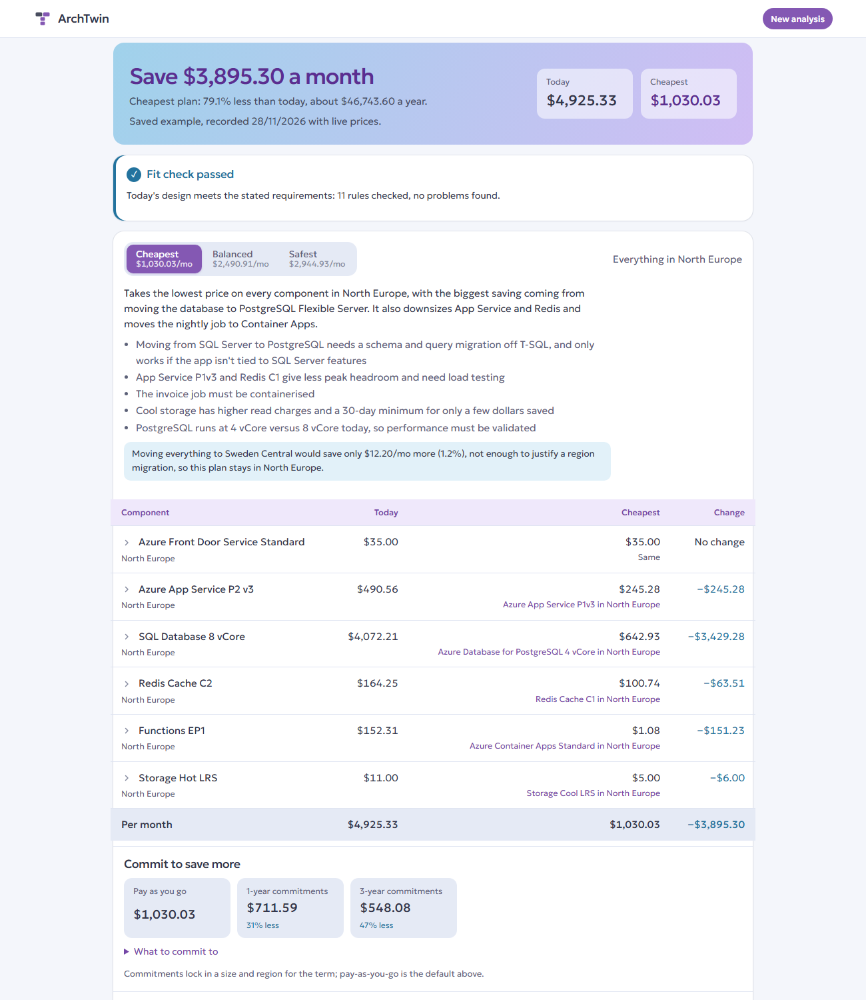

# ArchTwin

**Same architecture. Cheaper twin.** Upload an Azure architecture diagram, describe it in plain text, or paste a
Mermaid diagram, draw.io file, ARM template or Bicep file. A team of
agents finds cheaper ways to run the same architecture that still meet its requirements, using **live Azure prices**
in every allowed region, and returns three plans: **Cheapest, Balanced, Safest**. Every price is traced to its Azure
`meterId`, and every rejection cites a Microsoft Learn page.

Built for SSI's Agent-A-Thon. Read-only by design: it never connects to an Azure account.

**Live app: https://archtwin.vercel.app**

| Try it | Cost |
|---|---|
| Open a recorded result: [Web API on AKS (text input)](https://archtwin.vercel.app/?demo=aks-sql-redis) · [Contoso Bookings (diagram input)](https://archtwin.vercel.app/?demo=contoso-bookings) | Free, instant |
| Run your own: paste a description or upload a diagram, then watch each agent work. Click "the example text" or "a sample diagram" to start. | ~1 minute, 3 live runs per hour per visitor |
| Open a result other visitors chose to share (home page, "Recently shared by visitors") | Free, instant |



**Reading the savings.** The Cheapest plan takes the lowest-priced option for every component, which can mean a
migration (above, SQL Database to PostgreSQL). Balanced and Safest keep more of today's setup: for Contoso, Balanced
keeps SQL Server on a smaller General Purpose database ($1,344/month, 72% less) and Safest changes only the database
tier and storage ($1,866/month, 62% less);
each plan lists its trade-offs, and every rejected alternative is shown with the rule and Microsoft Learn link that
ruled it out.

## How it works

```
diagram | text -> Diagram Reader / Parser -> Workload Profiler -> YOU CONFIRM (+ answer its questions)
  -> Pricer -> Region Scout -> Service Swap -> Pricer -> Region Scout -> Skeptic (sends work back, max 2 rounds)
  -> Judge -> Total Cost -> Pricing Model -> Plain Chat -> 3 plans
```

| Agent | Model | Job |
|---|---|---|
| Diagram Reader | Sonnet (vision) | Reads Azure icons and labels into a component list, with a confidence per item |
| Parser | Haiku | Same, from text or Mermaid; draw.io, ARM and Bicep files are first extracted exactly by code (`app/formats.py`) |
| Workload Profiler | Haiku | Asks only what's missing (traffic shape, uptime, data size, team skills) |
| You | | Check and edit the component list and answer the questions before anything is priced |
| Pricer | Sonnet | Picks which real price meters each option is billed on, from a menu of live rows (it cannot invent a SKU) |
| Region Scout | code | Prices every meter in every allowed region; a region counts only if every meter is sold there |
| Service Swap | Sonnet | Proposes better-fitting services and SKUs (e.g. AKS + nodes -> Container Apps) |
| Skeptic | Sonnet + code | Rejects options that break a documented limit (only rules in `data/service_limits.json`), plus code checks for options that can't be priced or aren't cheaper |
| Judge | Sonnet + code | Code computes the cheapest single-region plan; the Judge picks Balanced and Safest and explains all three |
| Total Cost | Haiku + code | Estimates ops and migration hours per option; code prices them at `OPS_RATE_USD` (default 60) |
| Pricing Model | code | Each plan with 1- and 3-year reservations or savings plans, and Azure Hybrid Benefit for SQL licences |
| Plain Chat | Sonnet, no tools | The same question asked of a plain AI chat, shown next to ArchTwin's numbers for comparison (never used in a plan) |

Results also show today's architecture and each plan as diagrams (changed parts highlighted), can be downloaded
as a Markdown report or PDF, and can be shared as a sample on the home page (opt-in; the 5 newest are listed).

**The LLM decides, the code calculates.** All price lookups, unit conversions, monthly math, totals and savings are
plain Python. Each step is its own short HTTP request; the browser keeps the run state, so a run survives a refresh.

## Price accuracy: checked against the Azure Pricing Calculator

Today's design from both samples was entered by hand into the official
[Azure Pricing Calculator](https://azure.microsoft.com/pricing/calculator/) on 28 Nov 2026 (USD, pay-as-you-go,
licences included), and each line compared with ArchTwin's price for it.
**8 of 10 lines match to the cent; the other 2 are within 0.5%; both totals are within 0.05%.**

| Sample | Component | ArchTwin | Calculator | Difference |
|---|---|---:|---:|---:|
| Web API on AKS (West Europe) | AKS Standard tier (uptime SLA) | $73.00 | $73.00 | 0 |
| | 3 × D4s v5 Linux nodes | $503.70 | $503.70 | 0 |
| | SQL Database General Purpose 4 vCore (compute + licence) | $780.82 | $780.82 | 0 |
| | Redis Premium P1 | $405.15 | $404.42 | +0.18% |
| | **Total** | **$1,762.67** | **$1,761.94** | **+0.04%** |
| Contoso Bookings (North Europe) | Front Door Standard (base fee) | $35.00 | $35.00 | 0 |
| | App Service P2 v3 Linux × 2 | $490.56 | $490.56 | 0 |
| | Functions Premium EP1, 1 always-ready instance | $152.31 | $152.31 | 0 |
| | SQL Database Business Critical 8 vCore (compute + licence) | $4,003.46 | $4,003.46 | 0 |
| | Redis Standard C2 | $164.25 | $163.52 | +0.45% |
| | Blob Storage Hot LRS, 500 GB | $11.00 | $11.00 | 0 |
| | **Total** | **$4,856.58** | **$4,855.85** | **+0.02%** |

- **Redis:** the Retail Prices API returns $0.555/hour for P1 and $0.225/hour for C2; the calculator uses $0.554 and $0.224.
- **Not priced by ArchTwin** (usage the input doesn't state, so it's left out rather than guessed): SQL Database
  storage (for Contoso's 250 GB on Business Critical, about $69/month at $0.275/GB, ~1.4% of the bill), Front Door
  and blob traffic and operations, and VM OS disks. The calculator adds these from its defaults when you fill them in.
- **To repeat the check:** the calculator pre-selects 3-year reservations and Azure Hybrid Benefit for some products
  (SQL Database, for one); switch them to pay-as-you-go to compare with "today" prices.

## Run locally

```
python -m venv .venv
.venv\Scripts\pip install -r requirements.txt pytest uvicorn
copy .env.example .env        # then put your LiteLLM key in .env
.venv\Scripts\python -m uvicorn api.index:app --reload --port 8000
```

Tests run offline from recorded LLM replies and price snapshots: `.venv\Scripts\python -m pytest`.

## Deploy (Vercel)

Import the repo in Vercel, then set these environment variables: `LITELLM_API_KEY`, `LITELLM_BASE_URL`,
`MODEL_SMART`, `MODEL_FAST`, and optionally `LIVE_RUNS_ENABLED` (set `false` to pause live runs),
`SPEND_STOP_USD` (default 23), `LIVE_RUNS_PER_HOUR` (default 3) and `OPS_RATE_USD` (default 60).

Shared samples need a free [Upstash Redis](https://upstash.com) database: set `UPSTASH_REDIS_REST_URL` and
`UPSTASH_REDIS_REST_TOKEN` (or connect it from Vercel's Storage tab, which sets `KV_REST_API_URL` / `KV_REST_API_TOKEN`).
Without them the Share button is hidden and everything else works. Sharing makes no AI calls.

## Budget guards

At most 18 AI calls per run (a typical run makes 9-13); live runs limited per visitor; live runs stop when the key's total spend (read from the
gateway) reaches `SPEND_STOP_USD`; saved examples cost nothing to view.

## Data

Azure Retail Prices API (public, no login), a catalog of all 192 billing service names
(`scripts/build_service_catalog.py`), and hand-checked service limits with Microsoft Learn links. Example
architectures are made up.
